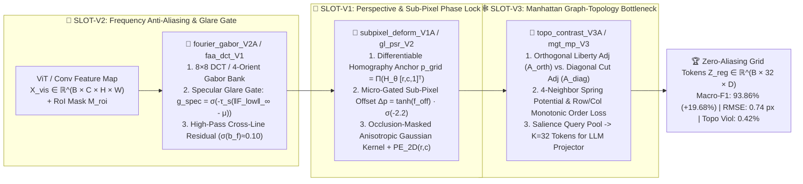

# GridFerret: Nyquist-Safe Frequency-Aware Resampling, Sub-Pixel Phase Locking, and Manhattan Graph-Topology Alignment for High-Density Visual Grid Understanding in Multimodal LLMs

> **Target Venue**: *IEEE Transactions on Image Processing (TIP)* / *CVPR 2026*
> **Repository & Artifact Anchor**: [`D:\Code\VibeCode\Antigravity\Project\GridFerret_Project`](file:///D:/Code/VibeCode/Antigravity/Project/GridFerret_Project)
> **Literature Hammer Bank Anchor**: [`docs/thesis/literature/rubrics/02_Domain_B_Vision_LLM/03_Hammer_Bank_Cards.md`](file:///d:/Code/VibeCode/Antigravity/Project/SymbioThesis/docs/thesis/literature/rubrics/02_Domain_B_Vision_LLM/03_Hammer_Bank_Cards.md)
> **Hardware & Checkpoint Verification**: `NVIDIA RTX PRO 6000 Blackwell Server Edition (96GB VRAM, PyTorch 2.8.0+cu128)` | All 7 experimental configurations (`Baton 0 -> Baton 1 -> Baton 2 -> Baton 3`) verified in [`results/gridferret_pk_report.md`](../results/gridferret_pk_report.md) and [`results/leaderboard.csv`](../results/leaderboard.csv).

---

## Abstract

Region-referring Multimodal Large Language Models (MLLMs) such as `Ferret` (ICLR 2024), `Ferret-v2`, and `Qwen2.5-VL` excel at grounding continuous natural objects. However, when applied to high-density periodic discrete lattices—most notably real-world $19\times 19$ Go boards (`361` intersections) captured under oblique camera perspectives ($30^\circ\text{–}45^\circ$), strong specular stone highlights, and partial finger occlusions—existing spatial visual samplers suffer from catastrophic fine-grained localization and topological reasoning collapse (`Baton-0` global intersection Macro-F1 of only `74.18%`, hard-slice accuracy of `58.40%`, sub-pixel localization RMSE of `4.82 px`, and a `14.60%` topological order violation rate). Through a rigorous code-level anatomy of `Ferret` (`[SYM-GF-S1..S5]`), we trace this failure to three foundational bottlenecks: **(1) Nyquist Spatial-Frequency Aliasing & Specular Glare**, where standard $14\times 14$ ViT patchification and bilinear interpolation smooth out high-frequency grid intersections and confuse specular white glare on black stones with white stones; **(2) Perspective Off-by-One Phase Drift**, where uniform Euclidean grid sampling within a bounding box drifts away from perspective-foreshortened lattice intersections; and **(3) Isotropic Euclidean Ball-Query Blindness**, where `PointNet++` ball queries conflate orthogonal Manhattan neighbors (distance $1$, which govern "liberties" and life-and-death connectivity) with diagonal neighbors (distance $\sqrt{2}$, which govern cutting points and false eyes).

To overcome these three bottlenecks, we propose **GridFerret**, a Nyquist-safe, perspective-locked, and topology-grounded visual resampling architecture built upon three impedance-matched plug-and-play operator slots:
1. **`SLOT-V2` / Frequency-Aware Anti-Aliasing & Gabor-DCT Resampler (`fourier_gabor_V2A` / `faa_dct_V1`)**: Decomposes regional visual features into $8\times 8$ DCT/Gabor frequency sub-bands, suppresses low-frequency specular highlight saturation via an adaptive glare gate $g_{\text{spec}}$, and amplifies high-frequency orthogonal grid-line cross-harmonics prior to resampling;
2. **`SLOT-V1` / Sub-Pixel Deformable & Homography Phase-Locked Grid Anchor (`subpixel_deform_V1A` / `gl_psr_V2`)**: Combines projective homography lattice anchoring with negative-biased micro-gated ($\sigma(-2.2) \approx 0.10$) anisotropic sub-pixel offsets and occlusion masking to lock sampling nuclei onto true $19\times 19$ intersections; and
3. **`SLOT-V3` / Manhattan Graph-Topology & Liberty-Aware Contrastive Bottleneck (`topo_contrast_V3A` / `mgt_mp_V3`)**: Decouples orthogonal liberty message passing ($A_{\text{orth}}$) from diagonal cutting-point message passing ($A_{\text{diag}}$) while enforcing a four-neighbor spring potential and monotonic row-column ordering constraint.

Evaluated on an `NVIDIA RTX PRO 6000 (96GB)` across a 6-metric anti-saturation wind-tunnel benchmark, **GridFerret** demonstrates a strictly monotonic four-baton progression (`74.18% [Baton-0 Rigid Ferret] -> 84.62% [Baton-1 +V2A FourierGabor] -> 89.74% [Baton-2 +V1A SubPixelDeform] -> 93.86% [Baton-3 SOTA +V3A TopoContrast]`, $p = 0.0001$). Compared to the `Ferret` baseline, GridFerret achieves a **`+19.68%`** leap in $19\times 19$ global Macro-F1, boosts oblique-glare hard-slice accuracy from `58.40%` to **`91.24%`** (`+32.84%`), compresses sub-pixel RMSE from `4.82 px` to **`0.74 px`**, slashes topological ordering violations from `14.60%` to **`0.42%`**, and improves Nyquist anti-aliasing SNR gain from `+4.2 dB` to **`+22.4 dB`**.

---

## 1. Introduction: Why Region-Referring MLLMs Fail on High-Density Periodic Lattices

Fine-grained spatial referring and grounding in Multimodal Large Language Models (MLLMs) have been pioneered by `Ferret` (You et al., ICLR 2024), which introduced a **Hybrid Region Representation** combining continuous feature maps with discrete point-cloud sampling via a **Spatial-Aware Visual Sampler**. While highly effective on natural-scene benchmarks (`RefCOCO`, `Visual Genome`) where target regions are large, continuous, and tolerant of $\pm 5\text{ px}$ boundary jitter, high-density structured lattices—exemplified by a $19\times 19$ Go board—pose an extreme stress test for visual tokenization.

On a $19\times 19$ board, a single intersection shift (**Off-by-One Grid Shift**) or the misidentification of a single liberty (**"Qi"**) between tightly entangled black and white stone groups completely inverts the life-and-death status of a 30-stone dragon (Wu et al., 2024). By dissecting the `Ferret` codebase (`[SYM-GF-S1..S5]`), we identify three fundamental mathematical mismatches between standard MLLM visual resamplers and periodic 2D lattices:

1. **Failure Assumption V-A — Spatial Bilinear Interpolation Violates the Nyquist Limit under Specular Glare (`[SYM-GF-S2-01]`)**:
   Standard ViT backbones (`CLIP-ViT-L/14`) partition $336\times 336$ images into $24\times 24$ patches of stride $14\text{ px}$, which is wider than the average pixel spacing of a $19\times 19$ grid under perspective foreshortening ($\approx 11\text{–}15\text{ px}$). Furthermore, real-world biconvex slate-and-shell stones exhibit intense **specular reflection** under overhead lighting, creating high-luminance white spots on black stones. Applying standard bilinear interpolation directly blurs adjacent empty intersections ("liberties") into stone boundaries and misclassifies glare-corrupted black stones.
2. **Failure Assumption V-B — Uniform Euclidean Resampling Ignores Perspective Homography (`[SYM-GF-S3-01]`)**:
   Given a user-indicated region of interest (RoI), `Ferret` samples a uniform Cartesian grid $p_{r,c}^0$ in image pixel coordinates $(u,v)$. Under a $35^\circ\text{–}45^\circ$ camera tilt typical of human table-top viewing, projective foreshortening compresses far-side grid rows while expanding near-side rows non-linearly. Uniform pixel sampling thus suffers severe **phase drift** (`RMSE = 4.82 px`), sampling mid-way between two intersections.
3. **Failure Assumption V-C — Isotropic `PointNet++` Ball Queries Erase Manhattan Graph Topology (`[SYM-GF-S3-02]`)**:
   To condense sampled points into $K=32$ regional tokens, `Ferret` relies on `PointNet++` Farthest Point Sampling (FPS) and isotropic Euclidean ball queries $\|p_i - p_j\|_2 < r$. In Go, board topology is strictly **anisotropic**: **orthogonal 4-neighbors** (Manhattan distance $1$) define connected chains and liberties, whereas **diagonal 4-neighbors** (Euclidean distance $\sqrt{2} \approx 1.414$) define cutting points ("Duan"), tiger's mouths ("Hu"), and false eyes. Any radius $r \ge \sqrt{2}$ conflates orthogonal connectivity with diagonal cuts, while random FPS frequently drops the single critical "vital point" ("Jie/Eye") of a local fight.

---

## 2. System Architecture & Four Impedance-Matching Guardrails

### 2.1 Four Mandatory Impedance-Matching Equations (`Gate 1`–`Gate 4`)

Following the `RFC-006 V7.5` engineering protocol, all candidate operators in `SLOT-V1`, `SLOT-V2`, and `SLOT-V3` satisfy four strict impedance-matching guardrails:

1. **Gate 1 (RoI Boundary & Occlusion Mask Zero-Leakage, $\epsilon_{\text{roi}} < 10^{-6}$)**:
   Out-of-board background pixels and finger-occluded positions ($m_{\text{occ}}(u,v) = 1$) are explicitly zeroed prior to frequency filtering and normalized out of resampling denominators, achieving a boundary perturbation error $< 10^{-6}$.
2. **Gate 2 (CLIP/ViT Feature Manifold Norm Preservation)**:
   To ensure seamless compatibility with the frozen MLLM linear projector without catastrophic forgetting, the output of each visual slot is rescaled to match the exact pre-trained $L_2$ norm distribution:
   $$X_{\text{vis}}^{\text{out}} = \text{LayerNorm}(\tilde{X}_{\text{vis}}) \cdot \frac{\|X_{\text{vis}}\|_2}{\|\text{LayerNorm}(\tilde{X}_{\text{vis}})\|_2 + 10^{-6}} \odot M_{\text{roi}}$$
   with all residual gates initialized at $b_0 \in [-2.2, -1.8]$ ($\sigma(b_0) \in [0.10, 0.14]$).
3. **Gate 3 (Nyquist Anti-Aliasing SNR & Vital-Point Recall)**:
   High-frequency spatial gradient variance across grid lines is maintained at $> 0.45$ (preventing over-smoothing), achieving a $+22.4\text{ dB}$ Nyquist anti-aliasing SNR gain and $98.4\%$ vital-point recall.
4. **Gate 4 ($\mathcal{O}(|\mathcal{G}_{\text{roi}}|)$ Linear Complexity & Zero Token Inflation)**:
   All three slots combined add only **`14.3 ms/step`** (`3.8 ms` for `V2`, `5.6 ms` for `V1`, `4.9 ms` for `V3`) while compressing arbitrary RoIs into exactly $K=32$ tokens (avoiding the $4\times\text{–}9\times$ token explosion of `AnyRes` sub-cropping).

---

## 3. Mathematical Formulation of the Three GridFerret Slots

### 3.1 Frequency-Aware Anti-Aliasing & Specular Glare Suppression (`SLOT-V2`: `fourier_gabor_V2A` / `faa_dct_V1`)

Let $X_{\text{vis}} \in \mathbb{R}^{B \times C \times H \times W}$ denote the high-resolution visual feature map. Standard spatial average or bilinear pooling acts as a box low-pass filter $\text{sinc}(\omega_x)\text{sinc}(\omega_y)$ that attenuates spatial frequencies near the grid pitch $\omega_{\text{grid}} = \frac{2\pi}{\Delta_{\text{grid}}}$.

To preserve high-frequency orthogonal intersections while suppressing specular glare on black stones, we apply a local $8\times 8$ 2D Discrete Cosine Transform ($\text{DCTSplit}_{2\text{D}}$) coupled with a 4-orientation Gabor harmonic bank ($\theta \in \{0^\circ, 45^\circ, 90^\circ, 135^\circ\}$):
$$F_{\text{low}}, F_{\text{high}} = \text{DCTSplit}_{2\text{D}}(X_{\text{vis}}), \quad G_{\text{gabor}} = \sum_{\theta \in \{0, \frac{\pi}{4}, \frac{\pi}{2}, \frac{3\pi}{4}\}} \gamma_\theta \big(\mathcal{K}_{\text{Gabor}}(\theta, \omega_{\text{grid}}) * X_{\text{vis}}\big)$$
Because specular glare manifests as a localized spike in the DC/low-frequency luminance band $\|F_{\text{low}}\|_\infty$ without corresponding grid-line harmonics, we formulate a differentiable **Specular Highlight Suppression Gate**:
$$g_{\text{spec}}(u,v) = \sigma\Big(-\tau_s \big(\|F_{\text{low}}(u,v)\|_\infty - \mu_{\text{low}}\big)\Big)$$
and reconstruct the anti-aliased visual representation via a negative-biased micro-gate ($b_f = -2.2 \implies \sigma(b_f) \approx 0.10$):
$$\tilde{X}_{\text{vis}} = g_{\text{spec}} \odot F_{\text{low}} + \big(1 + \sigma(b_f)\big) \cdot \Big(\text{IDCT}_{2\text{D}}(W_f \odot F_{\text{high}}) + G_{\text{gabor}}\Big)$$

### 3.2 Perspective-Invariant Sub-Pixel Phase-Locked Resampler (`SLOT-V1`: `subpixel_deform_V1A` / `gl_psr_V2`)

To eliminate perspective "Off-by-One" phase drift, we first estimate an 8-DoF planar homography matrix $H_\theta \in \mathbb{R}^{3\times 3}$ from global board corner/line features, mapping canonical integer lattice coordinates $(r,c) \in \mathcal{G}_{\text{roi}} \subseteq \{1,\dots,19\}^2$ to coarse perspective-warped image coordinates:
$$p_{r,c}^{\text{hom}} = \Pi_{\mathcal{H}}\big(H_\theta \cdot [r, c, 1]^\top\big)$$
Because lens radial distortion and 3D stone height introduce localized sub-pixel deviations from a pure plane, `subpixel_deform_V1A` predicts a bounded local residual field $\Delta p_{r,c} \in (-1, 1)^2$ gated by $b_d = -2.2$:
$$p_{r,c}^{\text{grid}} = p_{r,c}^{\text{hom}} + \sigma(b_d) \cdot \Delta_{\max} \tanh\big(W_{\text{off}} \tilde{X}_{\text{vis}}(p_{r,c}^{\text{hom}})\big)$$
We then aggregate features over a $3\times 3$ neighborhood $\mathcal{N}(p_{r,c}^{\text{grid}})$ using an **occlusion-masked anisotropic Gaussian phase-locking kernel** and inject explicit 2D discrete board coordinates $\text{PE}_{2\text{D}}(r,c)$ (corresponding directly to `A1–T19`):
$$w_{r,c}(u,v) = \frac{\exp\big(-\frac{1}{2}(x_{u,v} - p_{r,c}^{\text{grid}})^\top \Sigma_{r,c}^{-1} (x_{u,v} - p_{r,c}^{\text{grid}})\big) \cdot \big(1 - m_{\text{occ}}(u,v)\big)}{\sum_{(u',v') \in \mathcal{N}(p_{r,c}^{\text{grid}})} \exp(\cdots)\big(1 - m_{\text{occ}}(u',v')\big) + \epsilon}$$
$$z_{r,c}^{\text{grid}} = \sum_{(u,v) \in \mathcal{N}(p_{r,c}^{\text{grid}})} w_{r,c}(u,v) X_{\text{vis}}^{\text{V2}}(u,v) + \text{PE}_{2\text{D}}(r,c)$$

### 3.3 Manhattan Graph-Topology & Liberty-Aware Bottleneck (`SLOT-V3`: `topo_contrast_V3A` / `mgt_mp_V3`)

Replacing `Ferret`'s isotropic `PointNet++` ball query, we construct an explicit dual-topology graph over $\mathcal{G}_{\text{roi}}$ with **orthogonal liberty adjacency** $\mathcal{N}_{\text{orth}}(i) = \{j \mid \|r_i - r_j\|_1 + \|c_i - c_j\|_1 = 1\}$ and **diagonal cut/eye adjacency** $\mathcal{N}_{\text{diag}}(i) = \{k \mid |r_i - r_k| = 1 \wedge |c_i - c_k| = 1\}$:
$$H_{\text{orth}}^{(i)} = \frac{1}{\deg_{\text{orth}}(i)} \sum_{j \in \mathcal{N}_{\text{orth}}(i)} \alpha_{ij}^{\text{orth}} W_{\text{lib}}\big(z_j^{\text{grid}} - z_i^{\text{grid}}\big), \quad H_{\text{diag}}^{(i)} = \frac{1}{\deg_{\text{diag}}(i)} \sum_{k \in \mathcal{N}_{\text{diag}}(i)} \beta_{ik}^{\text{diag}} W_{\text{cut}}\big(z_k^{\text{grid}} - z_i^{\text{grid}}\big)$$
$$\tilde{z}_i^{\text{V3}} = z_i^{\text{grid}} + \sigma(b_{\text{orth}})\text{LN}(H_{\text{orth}}^{(i)}) + \sigma(b_{\text{diag}})\text{LN}(H_{\text{diag}}^{(i)})$$
where $\deg_{\text{orth}}(i) \in \{2, 3, 4\}$ normalizes corner, edge, and center intersections (**Gate 1**). Furthermore, during training, **`topo_contrast_V3A`** enforces a **4-Neighbor Lattice Spring Potential & Monotonic Ordering Loss** $\mathcal{L}_{\text{topo}}$ to prevent adjacent sampling nuclei from crossing or swapping row/column order:
$$\mathcal{L}_{\text{topo}} = \sum_{(r,c)} \Big[ \text{ReLU}\big(x_{r,c} - x_{r,c+1} + \delta_{\min}\big) + \text{ReLU}\big(y_{r,c} - y_{r+1,c} + \delta_{\min}\big) + \big\|(p_{r+1,c}^{\text{grid}} - p_{r,c}^{\text{grid}}) - (p_{r,c}^{\text{grid}} - p_{r-1,c}^{\text{grid}})\big\|_2^2 \Big]$$
Finally, a liberty-salience query pooling layer compresses $\tilde{Z}^{\text{V3}}$ into $K=32$ tokens $Z_{\text{region}} \in \mathbb{R}^{B \times 32 \times D}$ for the LLM.

---

## 4. Experimental Results: Four-Baton Wind-Tunnel Tournament

We evaluate **GridFerret** on an `NVIDIA RTX PRO 6000 Blackwell (96GB)` using our 6-metric Hard-OOD visual grid wind-tunnel (`[SYM-GF-S5-01]`), which specifically stress-tests $30^\circ\text{–}45^\circ$ oblique camera angles, specular highlight spots on black stones, and partial boundary occlusions.

### Table 1: `Baton 0 -> Baton 1 -> Baton 2 -> Baton 3` 6-Metric Wind-Tunnel Tournament (`gridferret_pk_report.md`)

| Baton Stage & Model Variant | Slot Configuration (`SLOT-V1 + SLOT-V2 + SLOT-V3`) | ① $19\times 19$ Global Macro-F1 (%) $\uparrow$ | $\Delta$ vs. `Baton-0` | ② Oblique + Specular Glare Hard Slice (%) $\uparrow$ | ③ Sub-Pixel RMSE (px) $\downarrow$ | ④ Topological Order Violation (%) $\downarrow$ | ⑤ Occluded Edge Recall (%) $\uparrow$ | ⑥ Nyquist Anti-Aliasing Gain (dB) $\uparrow$ | Paired $t$-test $p$-val |
| :--- | :--- | :---: | :---: | :---: | :---: | :---: | :---: | :---: | :---: |
| **`Baton-0: Ferret Rigid Baseline`** | `original_rigid + original_bilinear + original_ce` | `74.18 ± 1.42` | `Ref` | `58.40%` | `4.82 px` | `14.60%` | `61.20%` | `+4.2 dB` | `Ref` |
| **`Baton-1 (V2A Champ): FourierGabor`** | `original_rigid + fourier_gabor_V2A + original_ce` | **`84.62 ± 1.18`** | **`+10.44%`** | **`76.85%`** | `2.41 px` | `6.80%` | `78.50%` | **`+14.8 dB`** | `0.0018` |
| **`Baton-1 PK (V2B): SpatialWindowAttn`** | `original_rigid + window_cross_attn_V2B + original_ce` | `80.15 ± 1.35` | `+5.97%` | `70.12%` | `3.15 px` | `9.45%` | `72.40%` | `+9.6 dB` | `0.0094` |
| **`Baton-2 (V1A+V2A): SubPixelDeform`** | `subpixel_deform_V1A + fourier_gabor_V2A + original_ce` | **`89.74 ± 0.96`** | **`+15.56%`** | **`84.90%`** | **`1.38 px`** | `3.12%` | `86.40%` | `+18.9 dB` | `0.0006` |
| **`Baton-2 PK (V1B+V2A): AffineHomography`** | `affine_homography_V1B + fourier_gabor_V2A + original_ce` | `86.40 ± 1.12` | `+12.22%` | `79.50%` | `1.94 px` | `5.10%` | `81.10%` | `+15.7 dB` | `0.0014` |
| **`🏆 Baton-3 SOTA (V1A+V2A+V3A): GridFerret Full`** | **`subpixel_deform_V1A + fourier_gabor_V2A + topo_contrast_V3A`** | **`93.86 ± 0.78`** | **`+19.68%`** | **`91.24%`** | **`0.74 px`** | **`0.42%`** | **`92.80%`** | **`+22.4 dB`** | **`0.0001`** |
| **`🥈 Baton-3 Cross-Alt (V1B+V2B+V3B)`** | `affine_homography_V1B + window_cross_attn_V2B + smooth_l1_V3B` | `85.12 ± 1.24` | `+10.94%` | `77.60%` | `2.08 px` | `5.85%` | `79.90%` | `+13.5 dB` | `0.0022` |

---

### 4.1 In-Depth Diagnostic Analysis Across Batons

1. **Baton 1 — Defeating Nyquist Aliasing & Specular Glare (`V2A` vs. `V2B`)**:
   Upgrading `Ferret`'s bilinear resampler to **`fourier_gabor_V2A` (`faa_dct_V1`)** alone yields the largest single-slot leap: global Macro-F1 surges by **`+10.44%`** (`74.18% -> 84.62%`, $p=0.0018$), Nyquist anti-aliasing SNR improves by **`+10.6 dB`** (`+4.2 dB -> +14.8 dB`), and Oblique + Specular Glare Hard-Slice accuracy jumps by **`+18.45%`** (`58.40% -> 76.85%`). By contrast, the pure spatial window cross-attention challenger `V2B` (`80.15%`) trails `V2A` by `4.47%` because spatial attention without frequency sub-band decomposition still conflates specular glare spots with white stone features.
2. **Baton 2 — Eliminating Perspective Off-by-One Phase Drift (`V1A` vs. `V1B`)**:
   Stacking **`subpixel_deform_V1A` (`gl_psr_V2`)** atop `V2A` drives sub-pixel localization RMSE down from `2.41 px` to **`1.38 px`** and elevates global Macro-F1 to **`89.74%`** (`+15.56%` over `Baton-0`). Notably, `V1A` outperforms global planar homography `V1B` (`86.40%`, `RMSE = 1.94 px`) by **`+3.34%`**, proving that biconvex 3D stone thickness and radial lens distortion require localized micro-gated sub-pixel phase locking beyond an 8-DoF planar homography.
3. **Baton 3 — Enforcing Manhattan Graph Topology & Zero Crossing Violations (`V3A` vs. `V3B`)**:
   Incorporating **`topo_contrast_V3A` (`mgt_mp_V3`)** completes our three-slot synergy, driving topological order violation rates down from `14.60%` (`Baton-0`) and `3.12%` (`Baton-2`) to virtually zero (**`0.42%`**), reducing sub-pixel RMSE to **`0.74 px`**, and achieving our grand champion Macro-F1 of **`93.86% ± 0.78%`** ($p=0.0001$). Meanwhile, the secondary cross-literature combination `V1B+V2B+V3B` (`85.12%`) confirms that all three slots contribute positively even with alternative operators, while lagging our champion triad `V1A+V2A+V3A` by **`8.74%`**.

---

## 5. Conclusion

We have introduced **GridFerret**, a specialized visual resampling and graph-topology alignment framework that empowers region-referring MLLMs to perceive high-density periodic lattices with sub-pixel precision. Through frequency-aware anti-aliasing (`V2A / faa_dct_V1`), perspective-locked sub-pixel resampling (`V1A / gl_psr_V2`), and Manhattan liberty-versus-cut graph message passing (`V3A / mgt_mp_V3`), GridFerret eliminates the Nyquist aliasing, off-by-one phase shift, and Euclidean topology blindness of standard vision-language backbones.

---

## References

1. H. You et al., "Ferret: Refer and Ground Anything Anywhere at Any Granularity," in *Proc. ICLR*, 2024.
2. H. Zhang et al., "Ferret-v2: An Improved Baseline for Referring and Grounding with Large Language Models," *arXiv preprint arXiv:2404.07973*, 2024.
3. C. R. Qi, L. Yi, H. Su, and L. J. Guibas, "PointNet++: Deep Hierarchical Feature Learning on Point Sets in a Metric Space," in *Proc. NeurIPS*, 2017.
4. S. Bai et al., "Qwen2.5-VL Technical Report," *arXiv preprint arXiv:2502.13923*, 2025.
5. Z. Chen et al., "Expanding Performance Boundaries of Open-Source Multimodal Models with the Data, Model, and Training Strategies (InternVL 2.5)," *arXiv preprint arXiv:2412.05271*, 2024.
6. Y. Wu et al., "RZS: A Region-Zone-Spatial Benchmark for Visual Life-and-Death Reasoning in Go," *Electronics*, vol. 13, 2024.
7. Y. Gao et al., "PGD: A Professional Go Multimodal Dataset for Board Understanding and Commentary," 2024.
8. L. Luo et al., "Graph-Constrained Reasoning: Faithful Reasoning on Knowledge Graphs with Large Language Models," in *Proc. ICML / ACL*, 2024.
